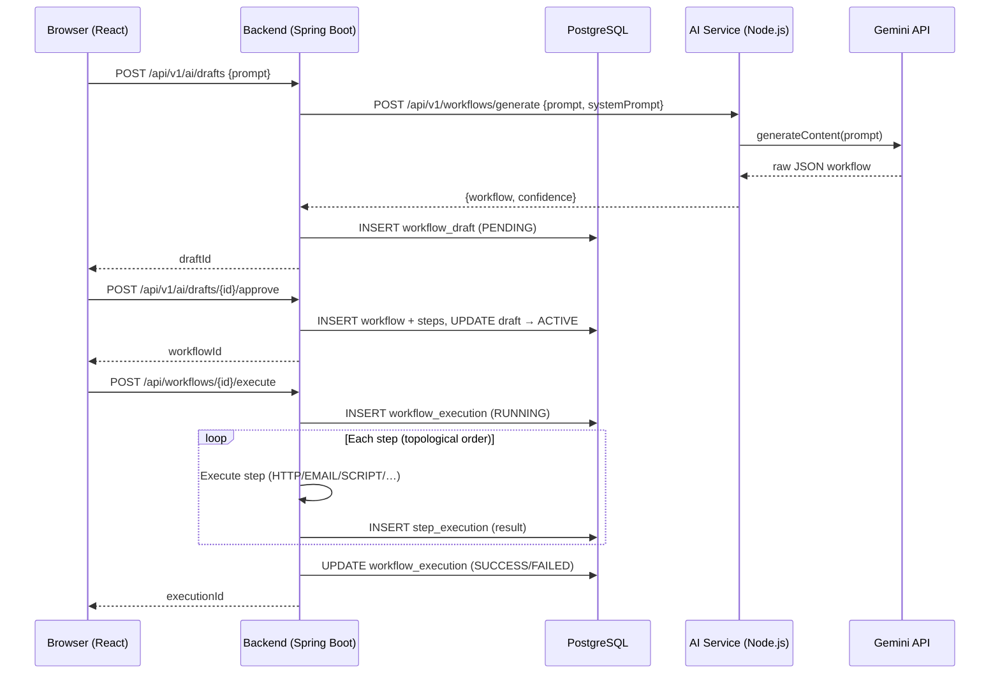

# Workflow Automation Platform

[](#)
[](#)
[](#)
[](#)
[](./LICENSE)

A multi-tenant workflow automation platform for designing, executing, scheduling, and monitoring automated business processes — with an integrated AI assistant (Google Gemini) for workflow drafting and execution log analysis.

---

## Table of Contents

- [Overview](#overview)
- [Architecture](#architecture)
- [Tech Stack](#tech-stack)
- [Key Features](#key-features)
- [Project Structure](#project-structure)
- [Getting Started](#getting-started)
  - [Prerequisites](#prerequisites)
  - [Environment Variables](#environment-variables)
  - [Local Development](#local-development)
  - [Docker Deployment](#docker-deployment)
- [API Reference](#api-reference)
- [Database](#database)
- [Security](#security)
- [Testing](#testing)
- [Known Issues](#known-issues)
- [Roadmap](#roadmap)
- [Contributors](#contributors)
- [License](#license)

---

## Overview

The Workflow Automation Platform is a **three-service system** that enables teams to:

- **Design** automation workflows composed of sequential steps (HTTP, EMAIL, SCRIPT, LOG, DELAY, DATABASE, WEBHOOK) with configurable inputs and dependency ordering.
- **Execute** workflows on demand or on a cron schedule, with automatic retries using fixed or exponential back-off strategies.
- **Monitor** execution history, per-step logs, and aggregate analytics across all workflow runs.
- **Draft workflows using AI** — describe a process in plain language and receive a structured, reviewable workflow draft powered by Google Gemini.

The system uses stateless JWT authentication and strict service boundaries between the API, frontend, and AI microservice. A `TenantFilter` propagates organization context on each request; PostgreSQL Row-Level Security is bootstrapped via an init script but is not yet fully enforced via Flyway migrations.

---

## Architecture

```
┌─────────────────────────────────────────────────────┐
│                     Client Layer                    │
│              React 19 SPA — Port 3000               │
└──────────────────────┬──────────────────────────────┘
                       │ HTTPS / REST / JWT
                       ▼
┌─────────────────────────────────────────────────────┐
│                  Application Layer                  │
│         Spring Boot 3.2.2 (JDK 17) — Port 8080     │
│  ┌──────────────┐  ┌───────────────┐  ┌──────────┐  │
│  │  Auth (JWT)  │  │ Workflow CRUD │  │ DAG Exec │  │
│  └──────────────┘  └───────────────┘  └──────────┘  │
│  ┌──────────────┐  ┌───────────────┐  ┌──────────┐  │
│  │ Cron Sched.  │  │ Retry Engine  │  │ AI Proxy │  │
│  └──────────────┘  └───────────────┘  └──────────┘  │
└───────────────┬────────────────────────┬────────────┘
                │ JDBC (HikariCP)        │ REST (WebClient)
                ▼                        ▼
   ┌─────────────────────┐   ┌──────────────────────────┐
   │  PostgreSQL 15      │   │ AI Microservice (Node.js) │
   │  JPA / Flyway (V3+) │   │ Express 5 — Port 3001    │
   └─────────────────────┘   │ Google Gemini integration │
                              │ MongoDB (drafts / logs)  │
                              └──────────────────────────┘
```

| Service | Runtime | Port | Datastore | Responsibility |
|---|---|---|---|---|
| **Frontend** | React 19 / CRA | 3000 | — | SPA with client routing, JWT session management in localStorage, workflow builder UI, AI draft review/smart config, client-side analytics & log viewer |
| **Backend** | Spring Boot 3.2.2 / JDK 17 | 8080 | PostgreSQL 15 | Core domain logic, DAG execution engine, cron scheduling, AI proxy, auth (registration & login) |
| **AI Service** | Node.js ESM / Express 5 | 3001 | MongoDB | Gemini LLM integration, workflow draft generation, execution log anomaly analysis, retry recommendation, email body generation |

Inter-service calls: Frontend → Backend (REST/JWT); Backend → AI Service (REST, `AI_SERVICE_API_KEY` header).

---

## Data Flow



---

## Tech Stack

### Backend
| Technology | Version | Purpose |
|---|---|---|
| Java | 17 (toolchain) | Runtime |
| Spring Boot | 3.2.2 | Application framework |
| Spring Security + JJWT | 0.12.6 | Stateless JWT authentication |
| Spring Data JPA + WebFlux | — | ORM / persistence, reactive HTTP client |
| Spring Boot Mail | — | Email step execution |
| PostgreSQL | 15 | Primary datastore |
| Flyway | — | Versioned schema migrations (V3, V4 present) |
| GraalVM JS | 23.0.1 | Sandboxed in-process JS execution (SCRIPT steps) |
| Testcontainers | 1.19.3 | Declared in build.gradle.kts (unused by current tests) |
| Lombok | — | Boilerplate reduction |
| Gradle | 8.14.5 (wrapper) | Build automation |

### Frontend
| Technology | Version | Purpose |
|---|---|---|
| React | 19 | UI framework |
| React Router DOM | 7 | Client-side routing |
| Axios | 1.x | HTTP client (JWT interceptor) |
| react-scripts (CRA) | 5.0.1 | Build tooling / test runner |

### AI Service
| Technology | Version | Purpose |
|---|---|---|
| Node.js (ESM) | 18+ | Runtime |
| Express | 5 | HTTP framework |
| @google/generative-ai | 0.24.x | Gemini LLM integration |
| Mongoose | 9.x | MongoDB ODM |
| Zod | 3.x | Schema / request validation |
| Helmet | 8.x | Secure HTTP headers |
| express-rate-limit | 8.x | Per-endpoint rate limiting |
| nodemon | 3.x | Hot reload (dev only) |

### Infrastructure
| Technology | Purpose |
|---|---|
| Docker + Docker Compose | Containerization — covers backend + PostgreSQL + frontend |
| PostgreSQL 15 | Backend persistence |
| MongoDB | AI service draft and execution log storage |

---

## Key Features

| Feature | Status | Description |
|---|---|---|
| **Workflow CRUD** | Implemented | Create, view, update, and delete workflow definitions |
| **Step Composition** | Implemented | Supports HTTP, EMAIL, SCRIPT (GraalVM JS), LOG, DELAY, DATABASE, and WEBHOOK step types |
| **DAG Execution Engine** | Implemented | Topological sorting and step dependency resolution |
| **Retry Mechanism** | Implemented | Per-step retry tracking with fixed and exponential back-off strategies |
| **Cron Scheduling** | Implemented | Timezone-aware workflow scheduling with enable/disable toggles |
| **AI Workflow Drafting** | Implemented | Generate workflow drafts from plain language using Google Gemini (`PENDING`, `ACTIVE`, `REJECTED`) |
| **AI Log Analysis** | Implemented | Anomaly detection and retry recommendation for failed runs |
| **Authentication** | Implemented | Stateless JWT authentication with user and organization registration |
| **Multi-Tenancy** | Implemented | Organization-level isolation via `TenantFilter` context propagation |
| **Analytics Dashboard** | Implemented | Client-side execution analytics and per-step log inspection |
| **PostgreSQL Row-Level Security** | Partial | Application-layer filtering active; `01-rls.sql` init script is a stub |
| **Flyway Schema Management** | Partial | V3 and V4 migrations present; Flyway disabled by default (`ddl-auto: update` used in dev) |
| **Docker Compose Orchestration** | Partial | Covers backend, frontend, and PostgreSQL; AI service is run separately |

---

## Project Structure

```
workflow-automation/
│
├── backend/                              # Spring Boot application
│   ├── app/
│   │   ├── build.gradle.kts
│   │   └── src/main/java/com/company/workflowautomation/
│   │       ├── ai/                       # AI proxy controller, draft domain
│   │       ├── auth/                     # JWT filter, SecurityConfig, AuthController
│   │       ├── config/                   # CorsConfig, WebClientConfig
│   │       ├── organization/             # OrganizationEntity, repository
│   │       ├── shared/                   # TenantFilter, CorrelationIdFilter, HealthController
│   │       ├── user/                     # UserEntity, UserRepository
│   │       ├── util/                     # SecurityUtils, PasswordHashedGenerator
│   │       ├── workflow/                 # Workflow domain (entity, JPA, service, controller, DTOs)
│   │       ├── workflow_execution/       # DAG engine, scheduler, retry, step execution
│   │       └── workflow_steps/           # Step domain (entity, service, controller)
│   │   └── src/main/resources/
│   │       ├── application.yml
│   │       ├── application-dev.yml
│   │       └── db/migration/             # V3__add_draft_status.sql, V4__add_schedule_unique_constraint.sql
│   ├── init-scripts/01-rls.sql           # PostgreSQL init (stub — SELECT 1)
│   ├── Dockerfile                        # Multi-stage: gradle:8.5-jdk21 builder → eclipse-temurin:21-jre
│   ├── docker-compose.yml                # db (postgres:15) + app (8080) + frontend (3000)
│   └── gradle/libs.versions.toml
│
├── frontend/                             # React SPA (Create React App)
│   ├── src/
│   │   ├── App.js                        # Route definitions
│   │   ├── components/                   # Login, Register, Workflows, WorkflowDetail,
│   │   │                                 # Executions, Analytics, Logs, Settings, AIDrafts,
│   │   │                                 # ProtectedRoutes, Layout
│   │   ├── services/api.js               # Axios client (JWT interceptor + all API calls)
│   │   └── styles/
│   └── package.json
│
├── ai-service/                           # Node.js AI microservice (ESM)
│   ├── index.js                          # Entry point — loads .env, starts server
│   ├── src/
│   │   ├── index.js                      # Express app setup, middleware, route wiring
│   │   ├── config/db.js                  # MongoDB connection
│   │   ├── controllers/workflow.controller.js
│   │   ├── middlewares/                  # errorHandler, rateLimiter, requestId
│   │   ├── models/                       # executionLog.model.js, workflow.model.js
│   │   ├── routes/                       # ai.routes.js, executionLogs.route.js,
│   │   │                                 # workflow.routes.js, execution.routes.js
│   │   ├── schemas/executionLog.schema.js
│   │   ├── services/                     # llm.service.js, anomaly, confidence,
│   │   │                                 # retryDecision, retryExecutor, emailBody
│   │   └── utils/promptTemplates.js
│   ├── .env.example
│   └── package.json
│
├── .env.example                          # Root env template (backend vars)
├── LICENSE
└── README.md
```

---

## Getting Started

### Prerequisites

| Tool | Version | Required For |
|---|---|---|
| Docker | 24+ | Full-stack local deployment |
| Docker Compose | v2+ | Multi-service orchestration |
| JDK | 17+ | Local backend development |
| Node.js | 18+ | Local frontend / AI service development |
| Gradle | 8.14.5 (wrapper included) | Backend builds |
| MongoDB | — | AI service (or use MongoDB Atlas) |

### Environment Variables

**Backend** — copy root `.env.example` and populate:

```bash
cp .env.example .env
```

| Variable | Description | Required |
|---|---|---|
| `SPRING_DATASOURCE_URL` | PostgreSQL JDBC URL (e.g. `jdbc:postgresql://localhost:5432/workflow_db`) | Yes |
| `SPRING_DATASOURCE_USERNAME` | PostgreSQL username | Yes |
| `SPRING_DATASOURCE_PASSWORD` | PostgreSQL password | Yes |
| `JWT_SECRET` | Secret key for signing JWTs (min. 256-bit) | Yes |
| `AI_SERVICE_URL` | Base URL of the AI microservice (default: `http://localhost:3001`) | Yes |
| `AI_SERVICE_API_KEY` | Shared secret sent as a header to the AI service | Yes |
| `MOCK_MODE` | `true` to bypass live Gemini calls in development | No |
| `SPRING_MAIL_HOST` | SMTP host (default: `smtp.gmail.com`) | No |
| `SPRING_MAIL_PORT` | SMTP port (default: `587`) | No |
| `MAIL_USERNAME` | SMTP username | No |
| `MAIL_PASSWORD` | SMTP password | No |

**AI Service** — copy `ai-service/.env.example` and populate:

```bash
cp ai-service/.env.example ai-service/.env
```

| Variable | Description | Required |
|---|---|---|
| `PORT` | Listening port (default: `3001`) | No |
| `LLM_PROVIDER` | LLM provider identifier (default: `gemini`) | No |
| `GEMINI_API_KEY` | Google Gemini API key | Yes |
| `GEMINI_MODEL` | Model identifier (e.g. `gemini-2.5-flash`) | Yes |
| `MONGODB_URI` | MongoDB connection string | Yes |
| `AI_TIMEOUT_MS` | Request timeout for Gemini calls (default: `60000`) | No |
| `MOCK_MODE` | `false` by default; `true` to stub LLM responses | No |
| `MAX_TEXT_LEN` | Max input length accepted for drafting (default: `2000`) | No |
| `LOG_RAW_AI` | Enable verbose AI response logging | No |

> **Security:** Never commit `.env` files. Rotate `JWT_SECRET` and `GEMINI_API_KEY` on any suspected exposure.

### Local Development

**Backend**
```bash
cd backend
./gradlew :app:bootRun
```
The build script reads `.env` from the repo root automatically. API available at `http://localhost:8080`.

> **Flyway / ddl-auto note:** There is no separate `application-prod.yml`. The single `application.yml` applies everywhere, including Docker. Flyway is disabled (`spring.flyway.enabled=false`) and `spring.jpa.hibernate.ddl-auto=update` runs in all environments unless overridden by env vars. For production use, set `SPRING_FLYWAY_ENABLED=true` and `SPRING_JPA_HIBERNATE_DDL_AUTO=validate`.
>
> **JDK note:** `build.gradle.kts` sets the Gradle toolchain to **JDK 17** (compiled bytecode target). The `Dockerfile` build stage uses `gradle:8.5-jdk21` and the runtime stage uses `eclipse-temurin:21-jre` — so the JDK 17 bytecode runs on a JDK 21 JRE (compatible). Local development requires JDK 17+.

**Frontend**
```bash
cd frontend
npm install
npm start          # starts local development server
npm run build      # creates production build in build/
```
The frontend dev server runs on port `3000` (`http://localhost:3000`). It connects to the backend API at `http://localhost:8080/api` (configured directly in `src/services/api.js`; no `.env` file or environment variable is configured).

**AI Service**
```bash
cd ai-service
cp .env.example .env      # populate GEMINI_API_KEY, GEMINI_MODEL, and MONGODB_URI
npm install
npm run dev               # hot-reload via nodemon
```
Available at `http://localhost:3001`.

### Docker Deployment

The `docker-compose.yml` is located in `backend/` and covers the backend API, PostgreSQL, and frontend:

```bash
cd backend
docker compose up --build -d
```

| Service | URL |
|---|---|
| Frontend | http://localhost:3000 |
| Backend API | http://localhost:8080 |
| PostgreSQL | localhost:5432 |

> The AI service must be started separately (see above). It is not included in `docker-compose.yml`.

```bash
# Tear down
docker compose down -v
```

---

## API Reference

All backend endpoints require `Authorization: Bearer <token>` except `/api/auth/**`.

### Authentication — `/api/auth`

| Method | Endpoint | Description |
|---|---|---|
| POST | `/api/auth/register` | Register a new user + organization |
| POST | `/api/auth/login` | Authenticate and receive a JWT |

### Workflows — `/api/workflows`

| Method | Endpoint | Description |
|---|---|---|
| GET | `/api/workflows` | List all workflows for the current tenant |
| POST | `/api/workflows` | Create a new workflow |
| GET | `/api/workflows/{id}` | Get workflow details |
| PUT | `/api/workflows/{id}` | Update a workflow |
| DELETE | `/api/workflows/{id}` | Delete a workflow |

### Workflow Steps — `/api`

| Method | Endpoint | Description |
|---|---|---|
| GET | `/api/workflows/{workflowId}/steps` | List steps for a workflow |
| POST | `/api/workflows/{workflowId}/steps` | Add a step to a workflow |
| GET | `/api/workflows/{workflowId}/required-inputs` | List required runtime inputs |
| PUT | `/api/steps/{id}` | Update a step |
| DELETE | `/api/steps/{id}` | Delete a step |

### Execution — `/api`

| Method | Endpoint | Description |
|---|---|---|
| POST | `/api/workflows/{workflowId}/execute` | Trigger a workflow run (optional JSON body for runtime params) |
| GET | `/api/workflows/{workflowId}/executions` | List executions for a workflow |
| GET | `/api/executions/{executionId}/steps` | Fetch per-step execution results |

### Schedule — `/api/workflows/{workflowId}/schedule`

| Method | Endpoint | Description |
|---|---|---|
| POST | `/api/workflows/{workflowId}/schedule` | Create a cron schedule |
| GET | `/api/workflows/{workflowId}/schedule` | Get current schedule |
| PUT | `/api/workflows/{workflowId}/schedule` | Update schedule |
| DELETE | `/api/workflows/{workflowId}/schedule` | Remove schedule |
| PATCH | `/api/workflows/{workflowId}/schedule/enable` | Enable schedule |
| PATCH | `/api/workflows/{workflowId}/schedule/disable` | Disable schedule |

### AI — `/api/v1/ai`

| Method | Endpoint | Description |
|---|---|---|
| POST | `/api/v1/ai/generate-workflow` | Generate a workflow draft from a plain-text prompt (Deprecated; frontend uses `/drafts`) |
| POST | `/api/v1/ai/analyze` | Analyze execution failure for anomalies + retry advice |
| POST | `/api/v1/ai/drafts` | Create a new AI draft (stores prompt + generated workflow) |
| GET | `/api/v1/ai/drafts` | List all drafts for the current user |
| GET | `/api/v1/ai/drafts/{draftId}` | Get a specific draft |
| POST | `/api/v1/ai/drafts/{draftId}/approve` | Approve draft → promotes to a live workflow |
| POST | `/api/v1/ai/drafts/{draftId}/reject` | Reject a draft |
| PUT | `/api/v1/ai/drafts/{draftId}/email-recipient` | Configure email recipient on a draft step |

### AI Service (direct) — `/api/v1`

The AI microservice exposes its own endpoints consumed by the backend and optionally callable directly:

| Method | Endpoint | Description |
|---|---|---|
| POST | `/api/v1/workflows/generate` | Generate workflow JSON from prompt & systemPrompt (internal contract) |
| POST | `/api/v1/analyze` | Anomaly detection + retry decision for a failed execution |
| POST | `/api/v1/execution/logs` | Persist an execution log to MongoDB + run anomaly detection |
| POST | `/api/v1/generate-email-body` | Generate custom email body text for a step using Gemini |
| GET | `/api/v1/execution/workflows/:id` | Fetch execution contract DTO for an ACTIVE workflow from MongoDB |
| GET | `/api/v1/workflows` | List workflows stored in MongoDB (supports CRUD) |
| GET | `/health` | Liveness check (returns `{ status: "UP" }`) |

### System — Backend

| Method | Endpoint | Description |
|---|---|---|
| GET | `/actuator/health` | Spring Boot Actuator liveness/readiness probe |
| GET | `/api/v1/health` | Custom backend service health check probe |

---

## Database

The backend uses PostgreSQL 15. In development, `spring.jpa.hibernate.ddl-auto=update` manages schema. In production/Docker, Flyway should be enabled (`spring.flyway.enabled=true`); two migrations are present:

| Migration | Description |
|---|---|
| V3 | Adds `status` and `approved_workflow_id` columns to `workflow_draft` |
| V4 | Adds unique constraint on `workflow_schedule` |

Key tables (managed by JPA entities):

| Table | Description |
|---|---|
| `organizations` | Root tenant entity |
| `users` | User accounts, scoped to organization |
| `workflow` | Workflow definitions (`name`, `description`, `status`) |
| `workflow_steps` | Step definitions with `depends_on` (JSONB), `step_type`, and `step_order` |
| `workflow_execution` | Per-execution records with `status` (`RUNNING / SUCCESS / FAILED`) and `trigger_data` (JSONB) |
| `step_execution` | Per-step records with `StepStatus` (`PENDING / RUNNING / SUCCESS / FAILED / SKIPPED`), `input_data`/`output_data` (JSONB), and `attempt_count` |
| `workflow_run` | Run tracking records with `WorkflowRunStatus` (`PENDING / RUNNING / RETRYING / SUCCESS / FAILED`), `retry_count`, and `error_message` |
| `workflow_schedule` | Cron scheduling with `cron_expression`, `timezone`, `enabled`, and `next_run_at` |
| `workflow_draft` | AI-generated drafts with `status` (`PENDING / ACTIVE / REJECTED`), `json_content`, and `approved_workflow_id` |

The AI service stores drafts and execution logs in **MongoDB** via Mongoose models (`workflow.model.js`, `executionLog.model.js`).

---

## Security

- **Authentication**: Stateless JWT (HS256), tokens signed with `JWT_SECRET`, expiry configurable (`jwt.expiration=3600000` ms default).
- **Authorization**: Organization-scoped; `TenantFilter` sets tenant context per request; `SecurityUtils` resolves the current user from the JWT.
- **Tenant Isolation**: Application-layer filtering via `TenantContextHolder`. PostgreSQL RLS init script (`01-rls.sql`) is currently a stub.
- **CORS**: Configured via `CorsConfig`.
- **AI Service Hardening**: Helmet for secure HTTP headers, Zod schema validation on all inbound requests, and per-endpoint rate limiting (`aiLimiter`, `logLimiter`, `generalLimiter`).
- **Transport**: TLS termination recommended at the reverse proxy layer in non-local environments.
- **Secrets**: Never commit `.env` files. Use a secrets manager in production.

---

## Testing

### Backend

```bash
cd backend
./gradlew :app:test
```

Test stack: JUnit 5, Spring Boot Test, Mockito (Testcontainers is declared in `build.gradle.kts` but unused by current tests; no Docker required).

### Frontend

```bash
cd frontend
npm install
npm test
```

Test stack: Jest and React Testing Library (via `react-scripts`).
Note: See [Known Issues](#known-issues) regarding a Jest test runner startup issue with `react-router-dom` v7.

### AI Service

Automated tests are not set up yet.

---

## Known Issues

- **Frontend `npm test` fails to start**: The application runs normally via `npm start`, but Create React App 5's bundled Jest cannot resolve `react-router-dom` v7 because it is ESM-only. Workarounds: configure Jest `moduleNameMapper` / `transformIgnorePatterns`, or use `react-router-dom` v6.
- **Hardcoded frontend API URL**: the base URL is set to `http://localhost:8080/api` in `src/services/api.js` (no environment variable); deploying elsewhere requires a code change.
- **Workflow schedule listing**: `WorkflowScheduleController.getSchedules()` ignores the `{workflowId}` path variable in `/api/workflows/{workflowId}/schedule` and returns all schedules across all workflows.
- **AI draft email recipient endpoint**: `configureDraftEmailRecipient` calls `/api/ai/...`, which the backend does not serve (backend routes are `/api/v1/ai/...`, and the backend expects `PUT /api/v1/ai/drafts/{draftId}/email-recipient`).

---

## Roadmap

The following items appear as TODOs or are structurally absent from the codebase:

- [ ] Full Flyway baseline migration (replace `ddl-auto: update` in dev)
- [ ] PostgreSQL Row-Level Security (complete `01-rls.sql`)
- [ ] Docker Compose integration for the AI service
- [ ] AI service test suite
- [ ] Frontend `test:coverage` script
- [ ] Webhook step type (schema already accepts `WEBHOOK` steps via AI normalization)
- [ ] Role-based UI permission gating
- [ ] Workflow versioning and rollback

---

## Contributors

| Name | Role |
|---|---|
| Sarvesh Joshi | Frontend (React) · Backend (Spring Boot) |
| Omkar Gaikwad | AI Service (Node.js · Express · Google Gemini · MongoDB) |

---

## License

This project is licensed under the **MIT License** — see [`LICENSE`](./LICENSE) for full terms.

© 2026 Sarvesh Joshi
